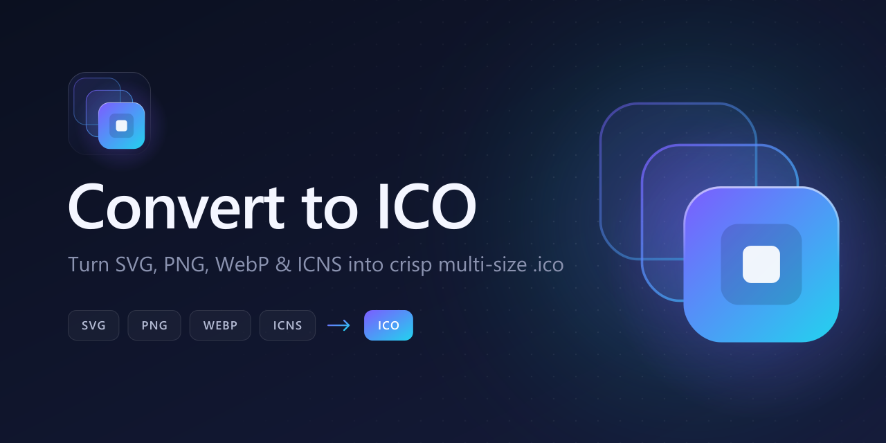
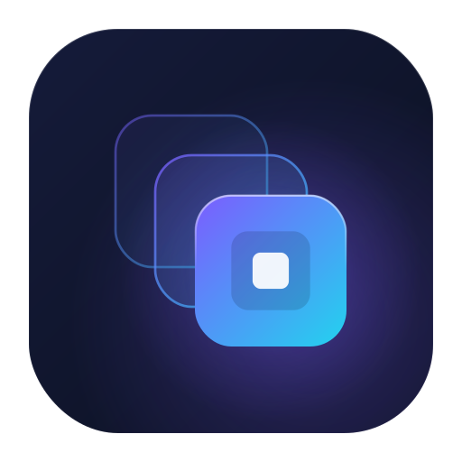

<p align="center">
  
</p>

<p align="center">
  
  
  
  
  
</p>

A small Python script that batch-converts SVG, PNG, WebP and ICNS images into multi-size Windows `.ico` files.

## Features

- Batch conversion of `.svg`, `.png`, `.webp` and `.icns` files in one run
- Each `.ico` contains six sizes: 16, 32, 48, 64, 128 and 256 px
- ICNS support: reads the largest embedded size to minimise upscaling
- Non-destructive: originals stay in `PNG/`, results are written to `icon/`
- Per-file `OK` / `FAIL` log with a final summary

## Quick start

```bash
git clone https://github.com/Shahat87/Convert_to_Icon-.git
cd Convert_to_Icon-
pip install -r requirements.txt
```

1. Drop your source files into `PNG/`.
2. Run the script:

   ```bash
   python convert_to_ico.py
   ```

3. Collect the results from `icon/`.

Example output:

```
OK: claude.svg
OK: logo.png
FAIL: broken.webp — <error message>

Done: 2 converted, 1 failed
```

## Windows note

The script is written for Windows with MSYS2-provided Cairo. At the top of `convert_to_ico.py` it unconditionally adds `C:\msys64\mingw64\bin` to `PATH` and to the DLL search path, before importing `cairosvg`.

Install Cairo from an MSYS2 MinGW64 shell:

```bash
pacman -S mingw-w64-x86_64-cairo
```

Because this setup runs for every file type and `cairosvg` is imported unconditionally, the MSYS2 directory must exist even if you only convert PNG, WebP or ICNS. Only SVG rendering actually uses Cairo. If your MSYS2 lives elsewhere, edit the path at the top of the script.

## How it works

| Step | What happens |
| ---- | ------------ |
| 1. Scan | Lists `PNG/` (sorted) and picks `.svg`, `.png`, `.webp`, `.icns`; other files are skipped |
| 2. Load | SVG is rendered to 256x256 with CairoSVG; PNG/WebP open with Pillow; ICNS loads its largest embedded size |
| 3. Resize | Image is converted to RGBA and resized to 256x256 with LANCZOS |
| 4. Save | Written to `icon/<name>.ico` with sizes 16, 32, 48, 64, 128, 256 |

## Project structure

```
convert_to_ico/
├── convert_to_ico.py   # the converter
├── requirements.txt    # Pillow, cairosvg
├── PNG/                # input: SVG, PNG, WebP, ICNS files
├── icon/               # output: generated .ico files (created on first run)
└── assets/             # README cover and logo
```

<p align="center">
  
  <br>
  <sub>Made by Shahat87</sub>
</p>
